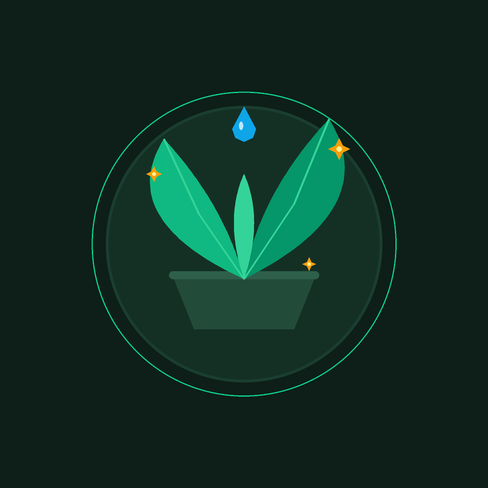
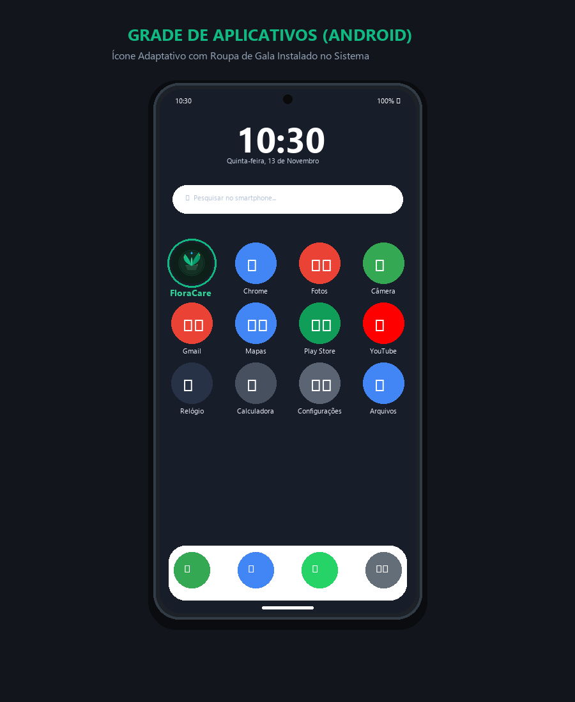
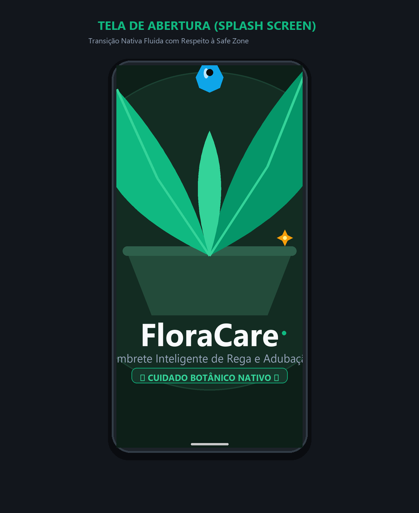
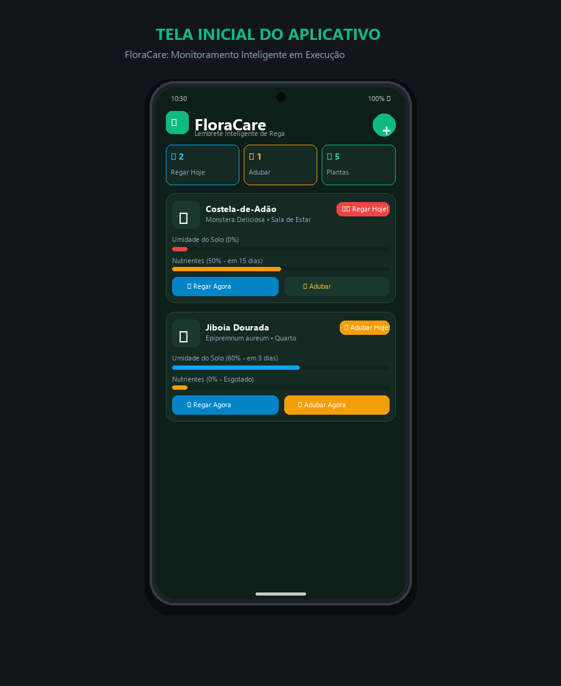

# 🌿 FloraCare — Lembrete Inteligente de Rega e Adubação de Plantas

<p align="center">
  
</p>

<p align="center">
  <strong>Identidade Visual Nativa, Branding e Automação de Assets para Android com Capacitor</strong>
</p>

<p align="center">
  
  
  
  
</p>

---

## 📱 Demonstração Visual ("Roupa de Gala")

O projeto conta com identidade visual completa e adaptada aos padrões nativos do Android, garantindo consistência visual desde a grade de aplicativos do sistema operacional até a tela de abertura e a interface do usuário.

<p align="center">
  
</p>

| Grade de Aplicativos (Android) | Tela de Abertura (Splash Screen) | Interface do App em Execução |
| :---: | :---: | :---: |
|  |  |  |
| *Ícone adaptativo integrado ao launcher nativo* | *Splash Screen com Safe Zone centralizada* | *Monitoramento de umidade e adubação em tempo real* |

---

## 🎯 Sobre o Projeto

O **FloraCare** é um aplicativo móvel voltado para apaixonados por botânica urbana e cuidados domésticos com plantas. Ele atua como um assistente botânico inteligente, monitorando ciclos biológicos de hidratação e fertilização.

### ✨ Principais Funcionalidades:
- **Painel de Ações Imediatas:** Indicadores rápidos para plantas que necessitam de rega ou adubação no dia.
- **Régua de Umidade e Nutrientes:** Barras de progresso com porcentagem dinâmica do nível de hidratação e tempo restante.
- **Ações com 1 Toque:** Registro imediato de rega ("Regar Agora") e adubação ("Adubar"), reiniciando automaticamente os ciclos.
- **Cadastro Personalizado:** Adição de novas plantas com nome popular, científico, frequência de rega/adubação, tipo de iluminação e notas.
- **Guia Botânico Rápido:** Dicas profissionais sobre substrato, horário de rega e teste de umidade.
- **Persistência Local:** Dados salvos localmente no dispositivo via `localStorage`.

---

## 🎨 Identidade Visual & *Branding*

A identidade do **FloraCare** foi desenvolvida para transmitir bem-estar, tecnologia e proximidade com a natureza.

### 📐 Resoluções Base e "Zonas Seguras" (Safe Zones)

| Ativo | Caminho | Resolução | Especificação de Design |
| :--- | :--- | :--- | :--- |
| **Ícone Oficial** | `assets/icon.png` | `1024 x 1024 px` | Fundo sólido opaco (`#0d1f18`), sem cantos arredondados manuais. Todo o grafismo essencial reside na **Safe Zone central circular (~66% / 676 px)** para suportar cortes de ícones adaptativos do Android (círculo, quadrado, esquilo). |
| **Tela de Abertura** | `assets/splash.png` | `2732 x 2732 px` | Fundo sólido opaco (`#0d1f18`) com a marca e logotipo contidos na **Safe Zone Central (~1200 px)** para evitar cortes em qualquer proporção de tela (16:9, 19.5:9, 21:9 e tablets). |

### 🎨 Paleta de Cores Oficial

| Cor | Hexadecimal | Uso no Sistema |
| :--- | :--- | :--- |
| **Verde Noturno Florestal** | `#0D1F18` | Fundo principal da aplicação e fundo nativo da Splash Screen |
| **Verde Esmeralda Vibrante** | `#10B981` | Cor primária da marca, botões de ação e ícone |
| **Azul Turquesa Água** | `#0EA5E9` | Indicador de rega, umidade e alertas de hidratação |
| **Âmbar Solar Nutriente** | `#F59E0B` | Indicador de adubação e bio-nutrientes |
| **Verde Musgo Elevado** | `#142A22` | Cartões e superfícies dos elementos da interface |
| **Branco Puro / Gelo** | `#F8FAFC` | Tipografia primária |

---

## ⚙️ Automação de Resoluções com `@capacitor/assets`

Para evitar o redimensionamento manual para dezenas de pastas do Android SDK, o pacote oficial `@capacitor/assets` foi instalado e configurado como dependência de desenvolvimento.

### Instalação:
```bash
npm install @capacitor/assets --save-dev
```

### Comando de Geração Automática:
```bash
npx capacitor-assets generate --android
```

### Arquivos Gerados Automaticamente em `android/app/src/main/res/`:
- `mipmap-mdpi/` (Densidade base 1x)
- `mipmap-hdpi/` (Alta densidade 1.5x)
- `mipmap-xhdpi/` (Extra alta densidade 2x)
- `mipmap-xxhdpi/` (Extra extra alta densidade 3x)
- `mipmap-xxxhdpi/` (Ultra densidade 4x)
- `mipmap-anydpi-v26/` (Ícones adaptativos com vetores XML)
- `drawable-port-*/` (Telas de splash para orientação retrato)
- `drawable-land-*/` (Telas de splash para orientação paisagem)
- `drawable-night-*/` (Telas de splash em modo escuro)

Após a geração, o projeto é sincronizado com o ambiente nativo:
```bash
npx cap sync android
```

---

## 🛠️ Configuração do `capacitor.config.ts`

O comportamento da Splash Screen nativa e a sincronização com o plugin do Capacitor foram declarados da seguinte forma:

```typescript
import type { CapacitorConfig } from '@capacitor/cli';

const config: CapacitorConfig = {
  appId: 'com.senai.floracare',
  appName: 'FloraCare',
  webDir: 'dist',
  plugins: {
    SplashScreen: {
      launchShowDuration: 2000,
      launchAutoHide: true,
      backgroundColor: '#0d1f18',
      androidSplashResourceName: 'splash',
      androidScaleType: 'CENTER_CROP',
      showSpinner: false,
    },
  },
};

export default config;
```

---

## 🚀 Compilação Automática na Nuvem (GitHub Actions)

O projeto conta com esteira de Integração Contínua (CI) configurada em `.github/workflows/android-build.yml`. A cada `git push` nas branches `main` ou `master`, o workflow:

1. Realiza o checkout do repositório.
2. Configura os ambientes **Node.js 20.x** e **Java OpenJDK 17**.
3. Instala as dependências e executa o build da aplicação web (`npm run build`).
4. Configura o **Android SDK** com `android-actions/setup-android@v3`.
5. Sincroniza o Capacitor com `npx cap sync android`.
6. Compila o APK nativo via Gradle (`./gradlew assembleDebug`).
7. Faz o upload do artefato compilado com o nome **`meu-aplicativo-apk`**.

### 📥 Como baixar o APK gerado no GitHub Actions:
1. Faça o `git push` do seu código para o repositório remoto no GitHub.
2. No seu repositório no GitHub, clique na aba **Actions** no topo da página.
3. Clique sobre o workflow mais recente executado (ex: *Build Android APK (Capacitor)*).
4. Assim que o indicador ficar verde com status **Success**, role até a seção **Artifacts** no rodapé.
5. Clique no artefato **`meu-aplicativo-apk`** para baixar o arquivo zip contendo o `app-debug.apk`.
6. Transfira para o seu dispositivo móvel Android e instale!

---

## 💻 Como Rodar o Projeto Localmente

### Pré-requisitos:
- Node.js >= 18.x
- Java JDK 17
- Android SDK instalado

### Passo a Passo:
```bash
# 1. Clonar o repositório
git clone https://github.com/SEU_USUARIO/SEU_REPOSITORIO.git
cd SEU_REPOSITORIO

# 2. Instalar dependências
npm install

# 3. Executar o servidor de desenvolvimento web
npm run dev

# 4. Gerar build de produção e sincronizar com Android
npm run build
npx cap sync android

# 5. Abrir no Android Studio ou rodar diretamente no dispositivo conectado via USB
npx cap open android
# ou
npx cap run android
```

---

## 📂 Estrutura do Repositório

```text
FloraCare/
├── .github/
│   └── workflows/
│       └── android-build.yml       # Pipeline CI/CD para compilar o APK na nuvem
├── assets/
│   ├── icon.png                    # Ícone fonte 1024x1024 (Safe Zone 66%)
│   ├── icon-foreground.png         # Camada frontal adaptativa
│   ├── icon-background.png         # Camada de fundo adaptativa
│   └── splash.png                  # Tela de abertura 2732x2732 (Safe Zone 1200px)
├── android/                        # Projeto nativo Android com mipmaps gerados
├── docs/                           # Mockups de apresentação do app e launcher
├── src/
│   ├── App.tsx                     # Interface do FloraCare em React
│   ├── main.tsx                    # Ponto de entrada da aplicação
│   ├── style.css                   # Design System e estilos botânicos nativos
│   ├── types.ts                    # Interfaces TypeScript
│   └── initialData.ts              # Dados botânicos iniciais
├── capacitor.config.ts             # Configuração oficial do Capacitor e Splash Screen
├── package.json
└── README.md                       # Documentação completa
```

---

<p align="center">
  Desenvolvido com 💚 para o curso de Desenvolvimento Mobile — SENAI.
</p>
